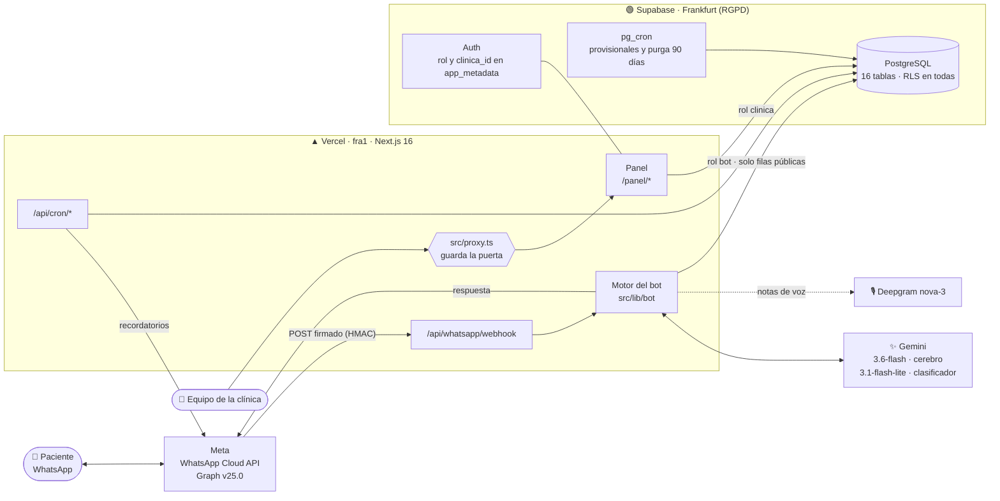
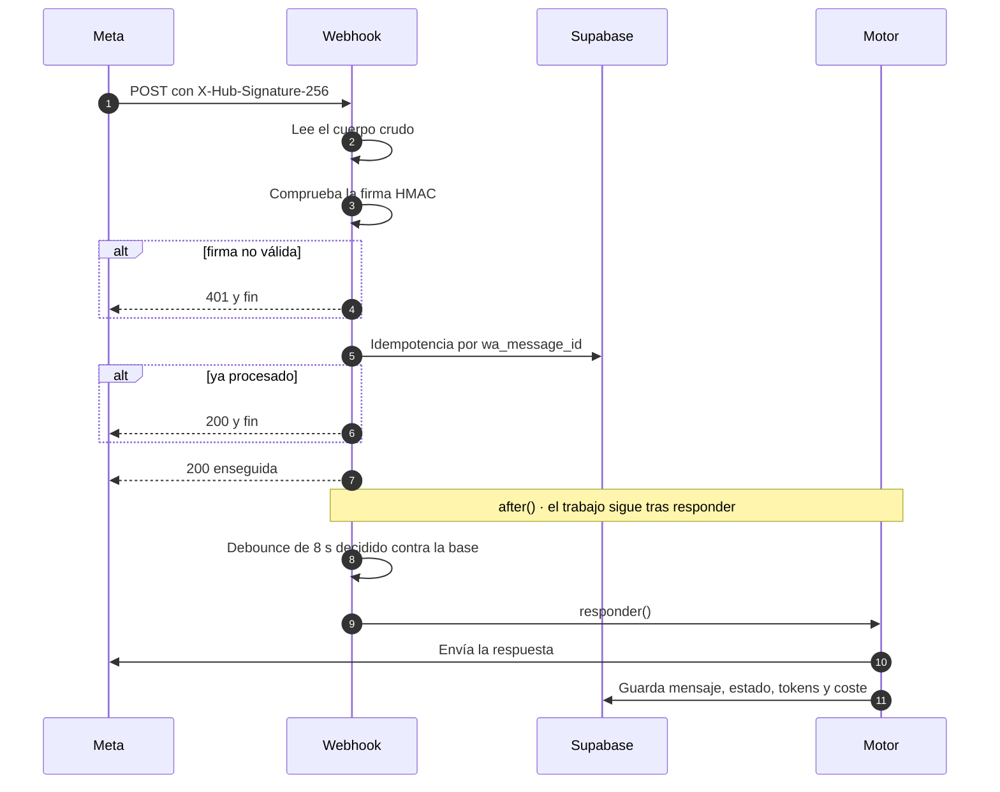
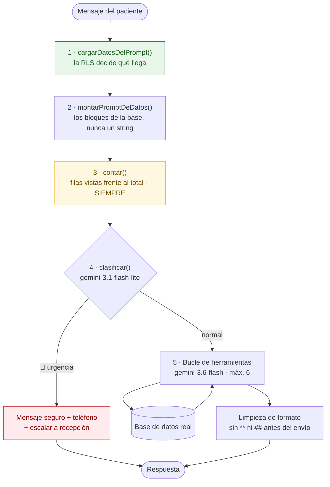
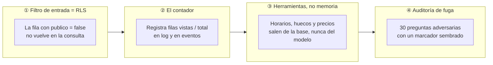
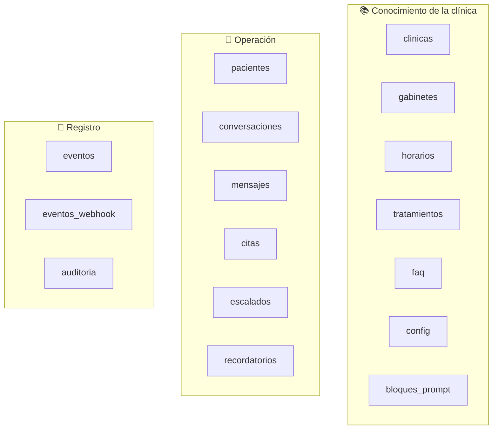
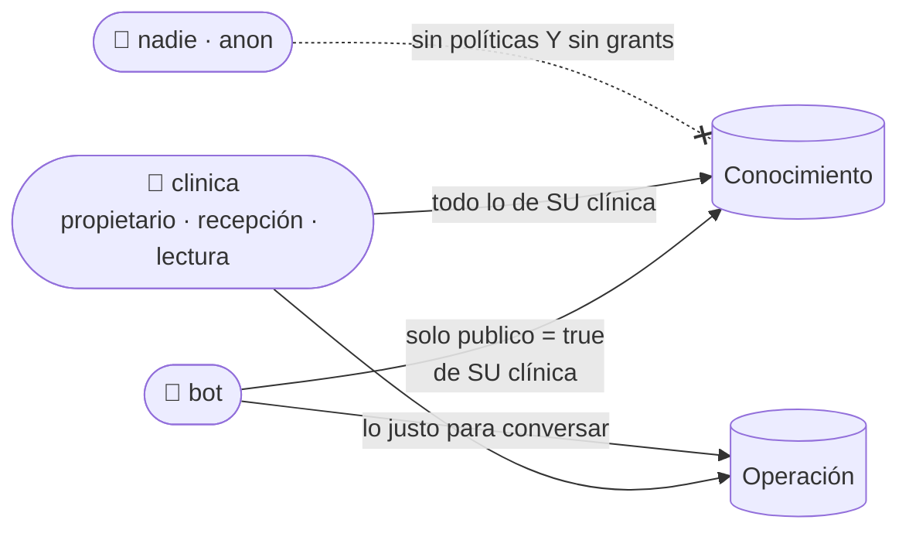
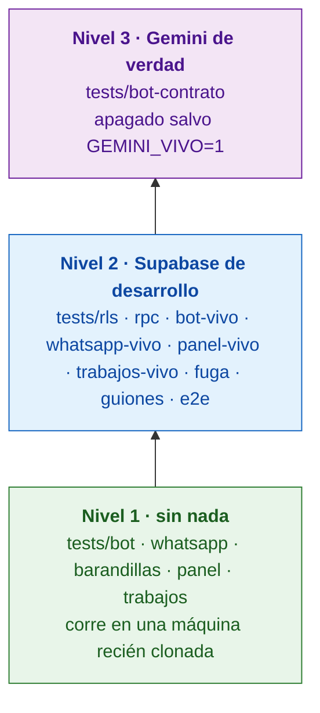
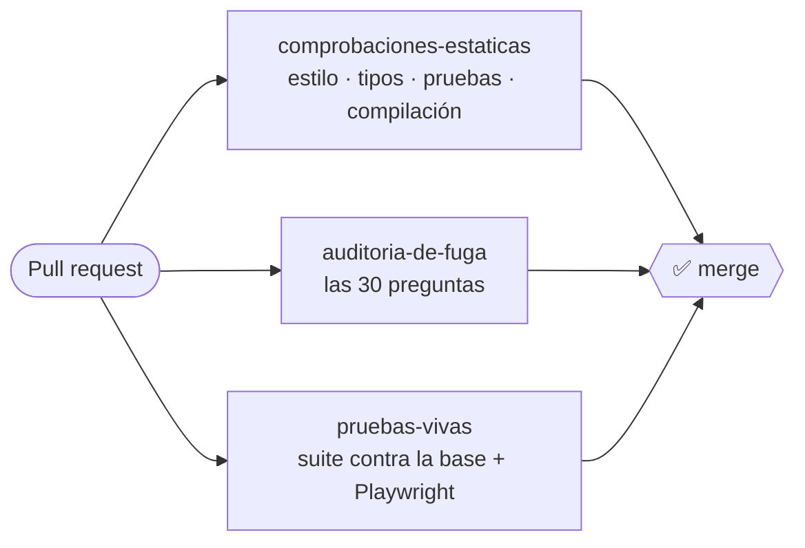
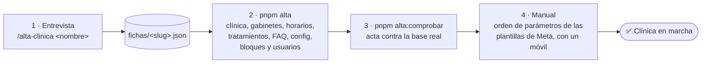

<div align="center">

# 🦷 Recepción IA Dental · WhatsApp

**Asistente de WhatsApp para clínicas dentales que coge citas, contesta las preguntas frecuentes con respuestas aprobadas y pasa a una persona cuando toca.**

Multi-clínica desde el primer día · V2 del asistente telefónico (`Bot Clinica Demo V1`)


</div>

> [!IMPORTANT]
> **El requisito que manda sobre todo lo demás: lo que el bot no debe decir, no le llega.**
> No es un filtro escrito en el prompt: es RLS. Para el rol `bot`, la fila confidencial **no existe**.

---

## 📑 Índice

1. [Qué hace](#-qué-hace)
2. [De V1 a V2](#-de-v1-a-v2)
3. [Arquitectura](#-arquitectura)
4. [El viaje de un mensaje](#-el-viaje-de-un-mensaje)
5. [Las cuatro barandillas](#-las-cuatro-barandillas)
6. [Las seis herramientas](#-las-seis-herramientas)
7. [Base de datos y roles](#-base-de-datos-y-roles)
8. [El panel de la clínica](#-el-panel-de-la-clínica)
9. [Trabajos programados](#-trabajos-programados)
10. [Estructura del proyecto](#-estructura-del-proyecto)
11. [Puesta en marcha](#-puesta-en-marcha)
12. [Pruebas](#-pruebas)
13. [Dar de alta una clínica](#-dar-de-alta-una-clínica)
14. [Estado por fases](#-estado-por-fases)
15. [Reglas que no se negocian](#-reglas-que-no-se-negocian)
16. [Documentación](#-documentación)

---

## 💬 Qué hace

| | El paciente… | El asistente… |
|:--:|---|---|
| 📅 | pide cita | consulta huecos **reales** en la base, ofrece 2–3 repartidos por el día y reserva **solo tras un «sí» explícito** |
| ❓ | pregunta horarios, precios, ubicación… | responde con la FAQ aprobada por la clínica, **palabra por palabra** |
| 🎙️ | manda una nota de voz | la transcribe (Deepgram `nova-3`, vocabulario dental) y sigue la conversación |
| 🚨 | escribe con dolor, hinchazón, golpe o sangrado | **no opina**: mensaje seguro + teléfono + aviso al equipo, sin pasar por el cerebro |
| 🙋 | quiere hablar con una persona | escala a recepción (una sola vez, con idempotencia) |
| ⏰ | tiene cita mañana | recibe un recordatorio con botones, en la zona horaria de la clínica |

Y siempre: se presenta como **asistente virtual** en el primer mensaje (art. 50 del Reglamento europeo de IA) y nunca dice «no te entiendo» a secas.

---

## 🔁 De V1 a V2

| | V1 · `Bot Clinica Demo V1` *(solo lectura)* | **V2 · este proyecto** |
|---|---|---|
| Canal | ☎️ Teléfono | 💬 WhatsApp Business Cloud API |
| Lenguaje | Python | TypeScript |
| Datos | Google Sheets | Supabase (PostgreSQL + RLS) |
| Clínicas | Una | **Multi-inquilino** |
| Modelo | Claude | Gemini (tier gratuito) para la primera clínica |

Lo que V1 dejó aprendido y V2 no repite:

- 🐛 Se ofrecían huecos que la reserva luego rechazaba → ahora `consultar_huecos` y `crear_cita` leen la misma verdad, con el constraint `sin_solape`.
- 🔁 El modelo escaló **cuatro veces** la misma llamada → escalado idempotente.
- 🧠 Un solo agente que lo hace todo **abandona tareas** a la quinta o sexta → clasificador primero, cerebro con seis herramientas después.

---

## 🏗️ Arquitectura



| Pieza | Tecnología |
|---|---|
| Web y API | Next.js 16 (App Router), React 19, TypeScript estricto |
| Estilos | Tailwind 3.4.17 · Lucide React |
| Datos y autenticación | Supabase: PostgreSQL, Auth, RLS · región EU (Frankfurt) |
| Inteligencia | `@google/genai`: `gemini-3.6-flash`, `gemini-3.1-flash-lite`, `gemini-embedding-001` (768 dims). **Versiones clavadas, nunca alias** |
| Voz | Deepgram `nova-3` en español |
| Canal | WhatsApp Business Cloud API oficial — **nunca** Baileys ni whatsapp-web.js |
| Validación | Zod |
| Pruebas | Vitest + Playwright |
| Despliegue | Vercel (`fra1`) + Vercel Cron + `pg_cron` |

---

## 📨 El viaje de un mensaje

### 1 · El webhook: el orden es la seguridad



**Una clínica = un `phone_number_id`.** El mapa vive en `WHATSAPP_CLINICAS` porque la RLS del rol `bot` necesita saber de qué clínica eres *antes* de poder leer nada; después se comprueba contra `clinicas.wa_phone_number_id`.

### 2 · `responder()`: el orden es el producto



> [!NOTE]
> El recordatorio de las reglas duras se reinyecta **al final** del contexto, detrás del historial (diez parejas): el modelo atiende al principio y al final, y el prompt de sistema queda en medio en cuanto la conversación crece.

---

## 🛡️ Las cuatro barandillas



| # | Barandilla | Qué garantiza | Quién la vigila |
|:-:|---|---|---|
| ① | **Filtro de entrada = RLS** | Lo confidencial no llega al prompt porque la consulta no lo devuelve | `tests/rls/`, `tests/barandillas/` |
| ② | **El contador** | Si el bot vio tantas filas como hay *habiendo alguna confidencial*, algo se ha roto | `tests/barandillas/03-filtro-y-contador.test.ts` |
| ③ | **Herramientas, no memoria** | El modelo nunca inventa horarios ni precios | `tests/bot/03-herramientas.test.ts`, `tests/guiones/` |
| ④ | **Auditoría de fuga** | Si el marcador aparece en una respuesta o en el prompt, **se bloquea el merge** | `tests/fuga/` + trabajo `auditoria-de-fuga` del CI |

> [!WARNING]
> **Prohibido duplicar en código un predicado que ya aplica la RLS.** Un `.eq('publico', true)` de más deja ciega a la barandilla ②: con la política rota, el contador seguiría diciendo «todo bien». La RLS filtra; el código comprueba y avisa. Lo vigila `tests/barandillas/04-sin-filtro-en-codigo.test.ts`.

La barandilla ④ tiene dos mitades: la que **bloquea el merge** usa un modelo falso que vuelca todo lo que ve (si el marcador no sale, es porque nunca entró), y la que habla con Gemini de verdad se ejecutó el 21/09/2026 con **cero fugas en treinta**.

---

## 🧰 Las seis herramientas

Ni una más. Cada una hace una cosa.

| Herramienta | Para qué |
|---|---|
| `anotar` | Guarda lo que el paciente dice, tal cual |
| `repasar_ficha` | Relee lo anotado antes de confirmar |
| `consultar_huecos` | Pide los huecos libres reales; se muestrean 2–3 repartidos por el día y **nunca se pasa el total** al modelo |
| `crear_cita` | Reserva. La confirmación se mide en el **mensaje del paciente**, no en un argumento del modelo |
| `no_te_entiendo` | Una sola ronda de aclaración, siempre diciendo qué **sí** puede hacer |
| `escalar_a_recepcion` | Pasa a una persona, de forma idempotente |

Constantes heredadas de V1: rejilla de **15 minutos** y citas como mucho a **120 días** vista.

---

## 🗄️ Base de datos y roles

Dieciséis tablas (quince de F1 y `recordatorios` de F6), **todas con RLS activada en la misma migración que las crea**.



**Tres roles, sacados de `app_metadata`** (nunca de `user_metadata`):



Detalles que importan:

- 🔒 `service_role` **jamás** sale del servidor: solo migraciones y scripts de alta, nunca en el camino del bot ni en el navegador.
- 🧩 `motivo_visita` es un **enum** (`revision`, `urgencia`, `estetica`, `ortodoncia`, `otro`), nunca texto libre: es lo que mantiene el sistema fuera del art. 9 del RGPD.
- 📆 Constraint `sin_solape` en `citas`: dos citas no pueden pisarse en el mismo gabinete.
- 🗑️ Los mensajes se purgan a los **90 días** con `pg_cron`.
- 👁️ Toda vista con `security_invoker = true`, `WITH CHECK` en todo `INSERT`/`UPDATE`, y ninguna `SECURITY DEFINER` sin justificación en un `COMMENT`.

Las migraciones están en [`supabase/migrations/`](supabase/migrations/).

---

## 🖥️ El panel de la clínica

Para la clínica, no para nosotros. Protegido por [`src/proxy.ts`](src/proxy.ts) (**nunca** `middleware.ts`, deprecado en Next 16).

| Sección | Ruta | Qué ve la clínica |
|---|---|---|
| 📅 Agenda | `/panel` | Las citas del día y la semana |
| 🔔 Avisos | `/panel/escalados` | La cola de escalados y urgencias |
| 💬 Conversaciones | `/panel/conversaciones` | Lo que se ha hablado, en **solo lectura** |
| 👥 Pacientes | `/panel/fichas` | Las fichas de pacientes |
| 📖 Lo que puede decir | `/panel/conocimiento` | FAQ y tratamientos con su interruptor `publico` |
| 👁️ Lo que ve el asistente | `/panel/observabilidad` | Lo que llega de verdad al prompt del bot |

> [!TIP]
> **El interruptor `publico` es el mando de la barandilla ①.** Se etiqueta en el idioma de la clínica («el asistente puede decir esto» / «solo para el equipo»), encenderlo pide confirmación mostrando el texto exacto, y cada cambio deja rastro en `auditoria`.

---

## ⏱️ Trabajos programados

Definidos en [`vercel.json`](vercel.json) (Vercel Cron) y en la base (`pg_cron`). Las rutas exigen `CRON_SECRET`, y **el código de estado es la alarma**: 200 limpio, 500 hay un problema, 503 no se ha podido comprobar.

| Ruta | Cuándo (UTC) | Qué hace |
|---|---|---|
| `/api/cron/recordatorios` | ⏰ cada hora | Manda la plantilla `recordatorio_cita` clínica por clínica. Idempotente por `unique (clinica_id, cita_id)` |
| `/api/cron/retencion` | 🌙 04:30 diario | **No borra nada**: comprueba que la purga de 90 días (`pg_cron`) está limpiando de verdad |
| `/api/cron/salud` | ☀️ 06:00 diario | Comprueba que los modelos de Gemini siguen respondiendo, antes de que lo note un paciente |
| `/api/cron/clinicas` | ☀️ 06:15 diario | Qué clínicas conoce el despliegue y si el bot puede atender a cada una |
| `pg_cron` | en la base | Purga el historial a los 90 días y libera las citas provisionales caducadas |

> El botón **CANCELAR** del recordatorio **no cancela**: escala a recepción y le dice al paciente que su cita sigue en pie. Cancelar por WhatsApp está fuera de esta versión.

---

## 📂 Estructura del proyecto

```text
📦 bot-clinica-whatsapp
├── 📁 src/
│   ├── 📁 app/
│   │   ├── 📁 api/
│   │   │   ├── 📁 whatsapp/webhook/   ← entrada de Meta
│   │   │   └── 📁 cron/               ← recordatorios · retencion · salud · clinicas
│   │   ├── 📁 entrar/                 ← inicio de sesión del panel
│   │   └── 📁 panel/                  ← las seis secciones del panel
│   ├── 📁 componentes/panel/          ← piezas de interfaz del panel
│   ├── 📁 lib/
│   │   ├── 📁 barandillas/            ← filtro · montaje · contador · origen
│   │   ├── 📁 bot/                    ← cerebro · clasificador · gemini · herramientas · historial · muestreo · validacion
│   │   ├── 📁 whatsapp/               ← firma · procesar · agrupar · enviar · audio · botones · plantillas · ventana…
│   │   ├── 📁 trabajos/               ← recordatorios · retencion · clinicas · reloj · cerrojo
│   │   ├── 📁 panel/                  ← consultas · acciones · sesión · guardia · auditoría
│   │   └── 📁 supabase/               ← navegador.ts · servidor.ts · bot.ts (tres clientes, tres roles)
│   ├── 📁 tipos/bd.ts                 ← tipos generados de la base
│   └── 📄 proxy.ts                    ← guardián del panel
├── 📁 contenido/bloques/              ← los bloques del prompt, en Markdown
├── 📁 supabase/migrations/            ← esquema, RLS, RPC, retención, trabajos
├── 📁 scripts/                        ← alta-clinica · comprobar-alta · sembrar-bloques · generar-tipos…
├── 📁 fichas/                         ← fichas de alta (solo ejemplo.json va al repositorio)
├── 📁 entregas/                       ← documentos para dar de alta y entregar a la clínica
├── 📁 tests/                          ← ver «Pruebas»
├── 📄 PLAN.md                         ← el plan del proyecto
└── 📄 ESTADO_F1…F10.md                ← qué se decidió (y descartó) en cada fase
```

---

## 🚀 Puesta en marcha

**Requisitos:** Node 20+, **pnpm** (nunca npm ni yarn) y un proyecto de Supabase de desarrollo.

```bash
# 1 · Dependencias
pnpm install

# 2 · Valores secretos: copia la plantilla y rellénala (nunca se sube)
cp .env.example .env.local

# 3 · Tipos de la base y bloques del prompt de una clínica de prueba
pnpm tipos
pnpm bloques <slug-de-la-clinica>

# 4 · Arrancar
pnpm dev        # → http://localhost:3000/panel
```

<details>
<summary>🔑 <b>Variables de entorno</b> (todas documentadas en <code>.env.example</code>)</summary>

| Grupo | Variables |
|---|---|
| Supabase | `NEXT_PUBLIC_SUPABASE_URL`, `NEXT_PUBLIC_SUPABASE_ANON_KEY`, `SUPABASE_SERVICE_ROLE_KEY`, `SUPABASE_JWT_SECRET`, `SUPABASE_PROJECT_REF`, `SUPABASE_DB_URL_DEV` |
| Inteligencia | `GOOGLE_AI_API_KEY` (cubre cerebro, clasificador y embeddings), `DEEPGRAM_API_KEY` |
| WhatsApp / Meta | `WHATSAPP_TOKEN`, `WHATSAPP_PHONE_NUMBER_ID`, `WHATSAPP_VERIFY_TOKEN`, `META_APP_SECRET`, `WHATSAPP_CLINICAS`, `GRAPH_API_VERSION`, `WHATSAPP_DEBOUNCE_MS` |
| Correo | `RESEND_API_KEY`, `EMAIL_REMITENTE` |
| Costes | `GEMINI_EUR_POR_MTOKEN_ENTRADA`, `GEMINI_EUR_POR_MTOKEN_SALIDA` |
| Trabajos | `CRON_SECRET`, `RECORDATORIO_HORAS_ANTES` |

> ⚠️ `SUPABASE_SERVICE_ROLE_KEY` **nunca** con prefijo `NEXT_PUBLIC_`.

</details>

<details>
<summary>📜 <b>Todos los comandos</b></summary>

| Comando | Qué hace |
|---|---|
| `pnpm dev` / `build` / `start` | Desarrollo, compilación y servidor |
| `pnpm lint` · `pnpm typecheck` | Estilo y tipos (deben quedar en 0) |
| `pnpm tipos` | Regenera `src/tipos/bd.ts` desde la base |
| `pnpm bloques <slug>` | Siembra `contenido/bloques/` en `bloques_prompt` |
| `pnpm alta fichas/<slug>.json` | Da de alta una clínica completa (`--continuar` para retomar) |
| `pnpm alta:comprobar` | Levanta el acta del alta contra la base real |
| `pnpm test` | Suite sin red externa |
| `pnpm test:<grupo>` | `rls`, `bot`, `bot-vivo`, `contrato`, `whatsapp`, `whatsapp-vivo`, `panel`, `panel-vivo`, `trabajos`, `trabajos-vivo` |
| `pnpm test:e2e` · `test:e2e:ui` | Playwright |

</details>

---

## 🧪 Pruebas

> **`pnpm test` no hace ni una llamada a Gemini, ni a Meta, ni a Deepgram.**



| Carpeta | Qué comprueba |
|---|---|
| `rls/` | La RLS está activada, aísla clínicas y el bot no ve lo privado |
| `barandillas/` | Montaje del prompt, contador y que no haya filtros duplicados en código |
| `bot/` · `bot-contrato/` | Validación, muestreo, herramientas, historial, clasificador · contrato con el SDK |
| `whatsapp/` | Firma, botones, formato, ventana de 24 h, reintentos, audio, webhook |
| `fuga/` | Las **30 preguntas adversarias** (barandilla ④) |
| `guiones/` | **15 conversaciones de referencia**: cita simple, para otra persona, fuera de horario, dolor fuerte, pide humano… |
| `e2e/` | Playwright: proxy, roles, aislamiento, interruptor y escalados |
| `trabajos/` · `cron/` | Recordatorios, provisionales, purga, retención |

**CI** ([`.github/workflows/ci.yml`](.github/workflows/ci.yml)) con tres trabajos:



> [!CAUTION]
> **Un verde no es una garantía.** Cero filas, un 200 o ningún error significan lo mismo si todo va bien que si no se ha comprobado nada. Antes de dar una prueba por buena, hay que **verla ponerse roja** rompiendo a propósito la garantía que dice medir.

---

## 🏥 Dar de alta una clínica

Un procedimiento, no cinco. Detalle completo en [`entregas/alta-de-una-clinica.md`](entregas/alta-de-una-clinica.md).



El acta **no dice «apto»**: dice cuatro de cinco, porque el quinto (el orden de los parámetros de las plantillas aprobadas en Meta) solo se comprueba con un móvil delante. Ver [`entregas/plantillas-meta.md`](entregas/plantillas-meta.md).

---

## 🗺️ Estado por fases

| Fase | Qué entrega | Estado |
|:--:|---|:--:|
| F0 | Esqueleto del proyecto y reglas del agente | ✅ |
| F1 | Base de datos multi-clínica, RLS y los tres clientes de Supabase | ✅ |
| F2 | Bloques de prompt y barandillas ① y ② | ✅ |
| F3 | Motor del bot: cerebro, seis herramientas y clasificador | ✅ |
| F3b | Estrechar la RLS a la conversación | ⏸️ Aparcada |
| F4 | Canal de WhatsApp: webhook, envío, plantillas, audio, debounce | ✅ |
| F5 | Panel de la clínica | ✅ |
| F6 | Trabajos programados | ✅ |
| F7 | Suite de conjunto: barandilla ④, quince guiones y CI | ✅ |
| F8 | Alta de clínica y entrega | ✅ |
| F9 | Publicación en producción | 🔄 Se cierra dentro de F10 (publicar la app de Meta) |
| F10 | La primera clínica de pago | 📝 Plan |

Cada fase tiene su `ESTADO_F<n>.md` con lo que se decidió **y lo que se descartó**.

---

## 📏 Reglas que no se negocian

<table>
<tr>
<td width="50%" valign="top">

**🗣️ Conversación**

- ❌ Nunca inventa un hueco: solo lo que devuelve `consultar_huecos`
- 📋 FAQ **palabra por palabra**, sin reformular
- ✋ Nada se escribe en la base sin confirmación explícita
- 🩺 Cero consejo médico, diagnóstico u opinión sobre síntomas
- 🤖 Se presenta como asistente virtual; no finge ser humano
- 🔁 Una sola ronda de aclaración, nunca bucles
- ✳️ En WhatsApp, `*simple*` es negrita; el markdown se limpia en código

</td>
<td width="50%" valign="top">

**🔐 Seguridad**

- 🔑 Secretos solo en `.env.local`; `.env.example` al día y vacío
- 🛡️ RLS en toda tabla nueva, en la misma migración
- 🚫 `service_role` jamás en el navegador ni en el bot
- 🏷️ `app_metadata`, nunca `user_metadata`
- 🌍 Datos en la UE (Frankfurt)
- 🚪 A producción con `--db-url`, nunca con `supabase link`
- 🔴 Todo paso que toca producción espera un «sí» explícito

</td>
</tr>
</table>

**🚧 No se toca sin confirmación explícita:** las políticas RLS de `supabase/migrations/`, los bloques de `contenido/bloques/`, el constraint `sin_solape` y los tres clientes de Supabase.

**📦 Fuera de alcance en esta versión:** bandeja de respuesta humana, cancelar o mover citas por WhatsApp, integración con Gesden o Dentalink, multi-sede, mensajes de captación y memoria entre conversaciones.

---

## 📚 Documentación

| Documento | Para qué |
|---|---|
| [`PLAN.md`](PLAN.md) | El plan completo: stack, barandillas, fases y pendientes |
| `ESTADO_F1.md` … `ESTADO_F10.md` | El diario de cada fase |
| [`.claude/CLAUDE.md`](.claude/CLAUDE.md) | Las reglas con las que trabaja el agente |
| [`entregas/alta-de-una-clinica.md`](entregas/alta-de-una-clinica.md) | Procedimiento de alta |
| [`entregas/hoja-para-la-clinica.md`](entregas/hoja-para-la-clinica.md) | Lo que se le pide a la clínica, en su idioma |
| [`entregas/plantillas-meta.md`](entregas/plantillas-meta.md) | Plantillas de WhatsApp y cómo comprobarlas |
| [`contenido/bloques/00 - LEEME primero.md`](contenido/bloques/00%20-%20LEEME%20primero.md) | Cómo funcionan los bloques del prompt |
